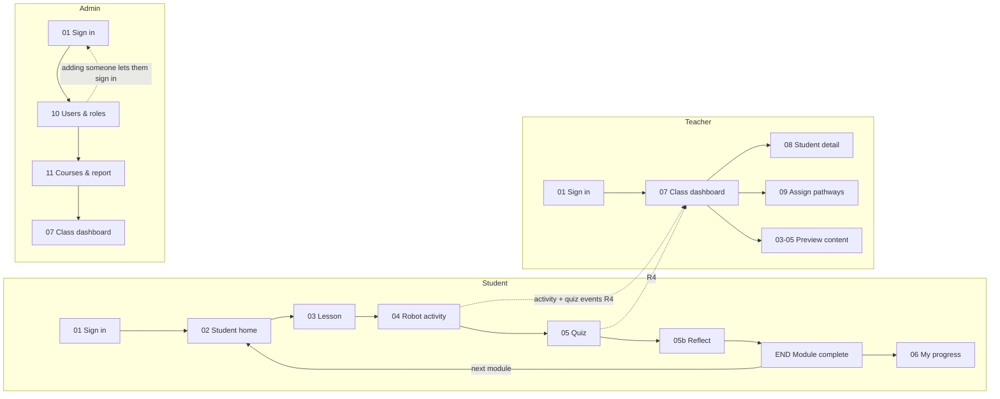

# RoboPath requirements map

**Version:** 1.0 (prototype)  
**Audience:** Grades 6–8 students, their teachers and school admins at Lincoln Middle School

Students learn programming and robotics through short modules: a lesson, a robot activity with instant feedback, a quiz and a reflection. Every action is saved and sent to the teacher's dashboard so the teacher can see who needs a hand.

**Sources:** ALL-screens-board.svg: user flow (00) and desktop screens 01–11; M1-phone-home.svg, M2-phone-activity.svg, M3-phone-dashboard.svg: phone layouts; robopath-all-modules.json: six modules with sections, assignments and quiz banks.

This file is generated from `data/requirements.json`, which also drives the in-app **Requirements map** page. Edit the JSON, not this file.

## 1. Roles

| Role | Signs in with | Can |
|---|---|---|
| Student | Google account on @students.lincolnms.org | See assigned and published pathways; Work through modules step by step; Run robot activities and quizzes with instant feedback; Write reflections; See their own progress, badges and module log |
| Teacher | Google Workspace account on @lincolnms.org | See the class dashboard for each class they teach; Open a student's detail and reflections; Assign and remove pathways with a due date and note; Preview any published module without saving progress |
| Admin | Google Workspace account on @lincolnms.org | Add users and set role, class and active state; Publish or hide courses (pathways); Read the system report; Open the class dashboard for any class |

## 2. User flow

## 3. Processes

### P1 Sign in and role routing

**Actor:** All roles  
**Trigger:** A person opens RoboPath.

| # | Screen | User action | System response | Requirements |
|---|---|---|---|---|
| 1 | 01 | Choose Student or Teacher or admin. | Shows the matching email domain hint. | R6.1 |
| 2 | 01 | Continue with Google. | Checks the domain, the roster and the active flag. | R6.2, R6.3, R6.4 |
| 3 | 01 | Sign-in refused (wrong domain, unknown, turned off, wrong role tab). | Explains why and how to fix it. | R6.3 |
| 4 | 02 / 07 / 10 | Lands on their home. | Student → Student home, Teacher → Class dashboard, Admin → Users & roles. | R6.5 |

**Outcome:** The person is signed in with one role and sees only that role's navigation.

### P2 Student learning loop

**Actor:** Student  
**Trigger:** Student presses Continue or Start on Student home or Pathways.

| # | Screen | User action | System response | Requirements |
|---|---|---|---|---|
| 1 | 02 | Pick up where you left off. | Opens the module at the first unfinished step. | R2.2 |
| 2 | 03 | Read lesson steps 1 and 2, press Next. | Marks the step done, saves, logs step_complete. | R1.1, R1.2, R2.1, R4.1 |
| 3 | 04 | Build a program and run it. | Animates the robot, gives instant feedback, logs activity_run. | R3.1, R3.2, R3.3, R4.1 |
| 4 | 05 | Answer and check each question, then submit. | Shows correct/incorrect feedback and hints, scores first tries, logs quiz_check and quiz_submit. | R3.4, R3.5, R4.1 |
| 5 | 05b | Write a reflection on the module assignment. | Saves the reflection for the teacher, logs reflection_submit. | R1.4, R4.1 |
| 6 | END | Module complete. | Shows what was finished and any new badge; offers the next module. | R1.5, R7.4 |
| 7 | 06 | Open My progress. | Shows modules done, quiz average, time building, steps finished, badges and module log. | R2.3, R2.4 |

**Outcome:** The module is complete, saved, and visible to the teacher.

### P3 Save and resume

**Actor:** Student  
**Trigger:** Any change to progress.

| # | Screen | User action | System response | Requirements |
|---|---|---|---|---|
| 1 | 03–05b | Finish a step, run a program, check an answer, write a reflection. | Writes the change to the learning store at once. | R2.1 |
| 2 | 02 | Sign out and sign back in, or close the tab. | Restores the current step, program, variable value, quiz answers and reflection draft. | R2.2 |

**Outcome:** No work is lost between sessions.

### P4 Event capture to dashboard

**Actor:** System  
**Trigger:** A student acts inside a module (dashed arrow on the user flow).

| # | Screen | User action | System response | Requirements |
|---|---|---|---|---|
| 1 | 04 / 05 | Activity runs and quiz checks happen. | Each is logged as an analytics event with user, module, step, result and time. | R4.1, R4.2 |
| 2 | 07 | Teacher opens the dashboard. | Recomputes tiles, support list, activity chart and module progress from events and progress. | R5.1, R5.2, R5.3, R5.4 |

**Outcome:** The teacher's view reflects what students did, with no manual reporting.

### P5 Find and support a student

**Actor:** Teacher  
**Trigger:** Needs support count is above zero.

| # | Screen | User action | System response | Requirements |
|---|---|---|---|---|
| 1 | 07 | Scan Who needs support. | Lists students flagged by the support rules with the reason. | R5.2 |
| 2 | 08 | Press View. | Opens student detail: chips, module table, reflections, suggested next step. | R5.5, R5.6 |
| 3 | 07 | Sort the roster to compare students. | Sorts by name, progress, quiz average or last active. | R5.7 |

**Outcome:** The teacher knows who to help first and what to do next.

### P6 Assignment lifecycle

**Actor:** Teacher  
**Trigger:** Teacher opens Assign pathways.

| # | Screen | User action | System response | Requirements |
|---|---|---|---|---|
| 1 | 09 | Choose a published pathway, a due date and an optional note. | Validates the form. | R7.1 |
| 2 | 09 | Assign to the class. | Adds it to Current assignments and to each student's home. | R7.2, R7.3 |
| 3 | 02 | Student sees the assignment banner with due date. | Marks due soon or overdue. | R7.3 |
| 4 | 09 | Track finished count or remove. | Shows X / class size finished; removal asks to confirm. | R7.4, R7.5 |

**Outcome:** Students know what to work on and by when.

### P7 Preview content

**Actor:** Teacher, Admin  
**Trigger:** Teacher opens Preview content.

| # | Screen | User action | System response | Requirements |
|---|---|---|---|---|
| 1 | 03–05 | Open any module step. | Runs the same lesson, activity and quiz in preview mode. | R8.1 |
| 2 | 03–05 | Try the activity and quiz. | Nothing is saved and no events are logged. | R8.2 |

**Outcome:** Teachers can check content before assigning it.

### P8 User provisioning

**Actor:** Admin  
**Trigger:** A new teacher or student joins.

| # | Screen | User action | System response | Requirements |
|---|---|---|---|---|
| 1 | 10 | Fill in Add a user. | Checks the email domain matches the role and the email is not already on the roster. | R9.3, R9.4 |
| 2 | 10 | Change role, class or active state on a row. | Saves at once; an admin cannot demote or turn off their own account. | R9.1, R9.2 |
| 3 | 01 | The new person signs in. | Adding someone lets them sign in; turning them off blocks sign-in. | R6.4 |

**Outcome:** The roster matches the school, and only rostered people can sign in.

### P9 Course publishing and system report

**Actor:** Admin  
**Trigger:** Admin opens Courses.

| # | Screen | User action | System response | Requirements |
|---|---|---|---|---|
| 1 | 11 | Publish or hide a course. | Hidden courses disappear for students and from the assign list; existing assignments are flagged. | R10.1, R10.2 |
| 2 | 11 | Read the system report. | Shows users, learning store rows, analytics events, published courses and events by type. | R10.3 |

**Outcome:** The admin controls what content is live and can see platform health.

## 4. Requirements

### R1 Lessons (Must)

Screens: 03, 05b, END. Each module is five steps: two lesson steps, a robot activity, a quick check and a reflection.

| ID | Requirement | Acceptance | Built in |
|---|---|---|---|
| R1.1 | Lesson steps render the module's section heading and body from modules.json, including code blocks, lists, quotes and bold text. | Step 1 shows section s1 and step 2 shows section s2 for every module. | `js/content.js, js/student.js` |
| R1.2 | A stepper shows all five steps with done, current and locked states. Done steps can be revisited. | Locked steps cannot be opened; finished steps show a check. | `js/student.js` |
| R1.3 | "Ask yourself" and "Tip" paragraphs are pulled out as callouts; a key-idea panel shows the module's learning outcomes. | Callouts appear on lesson steps where the JSON has them. | `js/content.js` |
| R1.4 | The Reflect step shows the module assignment instructions and a reflection box that needs at least 20 characters to finish. | Finish module stays disabled until the reflection is long enough. | `js/student.js` |
| R1.5 | Module complete shows the quiz score, any new badges and a button to the next module in the pathway (user flow: next module). | The next module opens at step 1. | `js/student.js` |

### R2 Saved progress (Must)

Screens: 02, 06, M1. Everything a student does is saved and restored.

| ID | Requirement | Acceptance | Built in |
|---|---|---|---|
| R2.1 | Step completion, activity program and variable value, quiz answers, reflection text and time spent are saved as they change. | Reloading the page restores the same state. | `js/store.js` |
| R2.2 | Student home shows a Pick up where you left off card with module, step and progress bar, opening the first unfinished step. | Continue opens the exact step shown on the card. | `js/student.js` |
| R2.3 | My progress shows modules done, quiz average, time building and steps finished. | Numbers match the module log. | `js/student.js, js/analytics.js` |
| R2.4 | Badges are earned from saved activity (first run, flag finder, bug squasher, sharp eye, pathway complete). | Earned badges are filled; others are outlined with how to earn them. | `js/analytics.js` |
| R2.5 | Pathway cards show a completion ring and each module's state with Review, Continue or Start. | Ring percent equals finished steps over total steps in the pathway. | `js/student.js` |

### R3 Instant feedback (Must)

Screens: 04, 05, M2. Students learn from every run and every answer.

| ID | Requirement | Acceptance | Built in |
|---|---|---|---|
| R3.1 | The robot grid is 6 x 6 (columns A–F left to right, rows 1–6 bottom to top) with shelves, a flag and the robot's heading. | Grid matches the activity's start, goal and shelves in activities.json. | `js/robot.js` |
| R3.2 | Students tap blocks to add them, remove them with ×, set the variable or repeat count with – and +, and cannot exceed the block limit. | Palette disables at the limit; counter shows used / limit. | `js/activities.js` |
| R3.3 | Run animates the robot move by move and ends with one of: flag reached (with block count and variable value), crash ("Bonk! Shelf at D3 on move 7."), off the mat, or stopped short (where it stopped and where the flag is). | Each outcome shows its own message; Next unlocks only after the flag is reached. | `js/robot.js, js/activities.js` |
| R3.4 | Each quiz question has its own Check answer. The JSON feedback text appears at once; correct and incorrect choices are coloured; a hint is available before checking. | A wrong check can be retried; the score uses first tries. | `js/activities.js` |
| R3.5 | Submit quiz is disabled until every question has been checked, with a count of questions left. | Counter reads "N questions left to check". | `js/activities.js` |
| R3.6 | Ordering and matching activities (modules 3, 4, 6) give per-item feedback explaining why each item belongs where it does. | Misplaced items are marked and the explanation shows after a correct check. | `js/activities.js` |

### R4 Activity and quiz events (Must)

Screens: 04, 05, 00. Student actions become analytics events that feed the teacher dashboard.

| ID | Requirement | Acceptance | Built in |
|---|---|---|---|
| R4.1 | Log events: sign_in, step_complete, activity_run (pass/fail and reason), quiz_check (correct or not), quiz_submit (score), reflection_submit, module_complete. | Each event stores user, class, module, step, result and timestamp. | `js/store.js` |
| R4.2 | Preview mode and seeded demo data never mix: preview logs nothing. | Events count is unchanged after a teacher preview. | `js/store.js` |

### R5 Class dashboard (Must)

Screens: 07, 08, M3. Teachers see who needs a hand.

| ID | Requirement | Acceptance | Built in |
|---|---|---|---|
| R5.1 | Tiles: Participating (students with activity in the last 7 days / class size), Progressing (average completion of assigned pathways), Quiz average, Needs support (highlighted). | Tiles recompute when students act. | `js/analytics.js, js/teacher.js` |
| R5.2 | Needs support rule: quiz average under 50%, or 3+ failed tries in a row, or no activity for 7+ days. The list shows the reason in words. | Kofi Mensah and Diego Santos appear with their reasons in the demo data. | `js/analytics.js` |
| R5.3 | Class activity chart: events per day for the last 14 days, today in the accent colour, with exact values on hover or focus. | Bars are drawn to one scale with a labelled axis. | `js/teacher.js` |
| R5.4 | Progress by module: per module, students done (dark) and in progress (accent) out of the class size. | Counts read "5/12" style. | `js/teacher.js` |
| R5.5 | Student detail dialog: status chips, module table (status and quiz), reflections and a suggested next step. | Escape and × close the dialog; focus returns to the View button. | `js/teacher.js` |
| R5.6 | Suggested next step is rule-based: re-teach the lowest-scoring module, unblock a stuck activity, or check in after inactivity. | Text names the module and the step. | `js/analytics.js` |
| R5.7 | Class selector switches between the teacher's classes; the roster table is sortable and each row opens student detail. | Sorting toggles ascending and descending. | `js/teacher.js` |

### R6 Sign-in and roles (Must)

Screens: 01. Only rostered school accounts sign in, and each sees their role's screens.

| ID | Requirement | Acceptance | Built in |
|---|---|---|---|
| R6.1 | Role toggle: Student or Teacher or admin. | Hint text shows the expected domain. | `js/auth.js` |
| R6.2 | Continue with Google (simulated in the prototype by an email field and demo account picker). | Valid accounts sign in with one action. | `js/auth.js` |
| R6.3 | Sign-in refused messages name the account and the fix: wrong domain, not on the roster, turned off, or wrong role tab. | dana.home@gmail.com on the staff tab shows the wireframe's message. | `js/auth.js` |
| R6.4 | Adding a user lets them sign in; turning a user off blocks sign-in. | Owen Brooks (turned off in the demo) is refused. | `js/auth.js, js/admin.js` |
| R6.5 | Role routing and navigation: student (Home, Pathways, My progress), teacher (Class dashboard, Assign pathways, Preview content), admin (Users & roles, Courses, System report, Class dashboard). | A role cannot open another role's screens. | `js/app.js` |

### R7 Assign pathways (Must)

Screens: 09, 02. Teachers assign whole pathways to a class with a due date.

| ID | Requirement | Acceptance | Built in |
|---|---|---|---|
| R7.1 | Form: pathway (published only, with module count), due date (today or later), note to students. | Invalid forms show an inline message. | `js/teacher.js` |
| R7.2 | Assign adds the assignment to Current assignments for that class. A pathway can be assigned once per class. | Duplicate assignment is refused with a message. | `js/teacher.js` |
| R7.3 | Students see assigned pathways on Student home with the due date, the note, and a due soon or overdue state. | Banner matches the teacher's assignment. | `js/student.js` |
| R7.4 | Current assignments show students finished / class size with a bar. | Count rises when a student completes the pathway's last module. | `js/teacher.js` |
| R7.5 | Remove asks for confirmation in the page before deleting. | Cancel leaves the assignment in place. | `js/teacher.js` |

### R8 Preview content (Should)

Screens: 03–05. Teachers and admins can walk through any module.

| ID | Requirement | Acceptance | Built in |
|---|---|---|---|
| R8.1 | Preview lists every pathway and module (hidden ones marked) and opens any step directly. | All five steps are unlocked in preview. | `js/teacher.js, js/student.js` |
| R8.2 | A banner states that preview saves nothing. | Progress and events are unchanged after preview. | `js/student.js` |

### R9 Users & roles (Must)

Screens: 10. Admins manage the roster.

| ID | Requirement | Acceptance | Built in |
|---|---|---|---|
| R9.1 | Table: name, school email, role, class, active. Role and class change from dropdowns; active from a toggle. | Changes save at once with a confirmation toast. | `js/admin.js` |
| R9.2 | An admin cannot change their own role or turn off their own account. | Own role select and toggle are disabled. | `js/admin.js` |
| R9.3 | Add a user: full name, school email, role, class. Students need @students.lincolnms.org; staff need @lincolnms.org. | A mismatched domain shows an inline error. | `js/admin.js` |
| R9.4 | Emails are unique on the roster. | Duplicate email is refused. | `js/admin.js` |

### R10 Courses & system report (Must)

Screens: 11. Admins control which courses are live and see platform totals.

| ID | Requirement | Acceptance | Built in |
|---|---|---|---|
| R10.1 | Each course (pathway) has a Published / Hidden toggle. | Engineering Design starts hidden in the demo. | `js/admin.js` |
| R10.2 | Hidden courses are removed from student views and the assign list; existing assignments are flagged for the teacher. | Hiding Programming Fundamentals removes it from Maya's home. | `js/student.js, js/teacher.js` |
| R10.3 | System report: users, learning store rows, analytics events, published courses, and events by type. | Totals change as people use the platform. | `js/admin.js, js/analytics.js` |

### R11 Phone layouts (Must)

Screens: M1, M2, M3. Every screen works at 390 px wide.

| ID | Requirement | Acceptance | Built in |
|---|---|---|---|
| R11.1 | Side navigation becomes a tab row under the header. | Matches M1 and M3. | `css/layout.css` |
| R11.2 | Robot activity stacks grid, program, variable, palette and run controls, with Back and Next fixed at the bottom. | Matches M2; no sideways scrolling. | `css/robot.css, css/layout.css` |
| R11.3 | Dashboard tiles go to a 2 x 2 grid; tables scroll inside their own container. | Matches M3. | `css/screens.css` |

### R12 Accessibility and quality (Should)

Screens: All. Usable by keyboard, readable, and respectful of motion settings.

| ID | Requirement | Acceptance | Built in |
|---|---|---|---|
| R12.1 | All controls reachable by keyboard with a visible focus ring; dialogs trap focus and close on Escape. | The full student loop can be finished with the keyboard. | `js/ui.js` |
| R12.2 | Feedback is announced to screen readers through a live region and never relies on colour alone. | Correct and incorrect states also show text and icons. | `js/ui.js` |
| R12.3 | Robot animation respects reduced motion; light and dark themes are both supported. | With reduced motion the robot jumps to each square. | `js/robot.js, css/tokens.css` |

## 5. Screens and wireframe callouts

| Screen | Name | Role | Callouts |
|---|---|---|---|
| 01 | Sign in | All | 1 Role toggle; 2 Sign-in refused message; 3 Continue with Google; 4 Hero illustration of the robot grid |
| 02 | Student home | Student | 1 Pick up where you left off; 2 Teacher assignment with due date; 3 Pathway completion ring; 4 Module rows with Review / Continue / Start |
| 03 | Lesson step | Student | 1 Five-step stepper; 2 Code example; 3 Next saves the step; 4 Key idea panel |
| 04 | Robot grid activity | Student | 1 Grid with shelves, flag, robot; 2 Program with block limit; 3 Variable stepper; 4 Instant feedback; 5 Run, Reset robot, Clear |
| 05 | Quiz with feedback | Student | 1 Per-question feedback; 2 Selected answer; 3 Check answer and hint; 4 Submit when all checked |
| 05b | Reflect | Student | Assignment instructions and reflection box |
| END | Module complete | Student | Score, badges, next module |
| 06 | My progress | Student | 1 Stat tiles; 2 Badges; 3 Module log |
| 07 | Class dashboard | Teacher, Admin | 1 KPI tiles; 2 Who needs support; 3 Class activity chart; 4 Progress by module; 5 Class selector |
| 08 | Student detail | Teacher, Admin | 1 Status chips; 2 Module table; 3 Reflections; 4 Suggested next step |
| 09 | Assign pathways | Teacher | 1 New assignment form; 2 Current assignments; 3 Assign button |
| 10 | Users & roles | Admin | 1 Role select (own locked); 2 Active toggle; 3 Email domain check; 4 Add user |
| 11 | Courses & system report | Admin | 1 Publish toggles; 2 System report |

## 6. Analytics events (R4)

| Event | When | Fields |
|---|---|---|
| `sign_in` | A person signs in | userId, role |
| `step_complete` | Next on a lesson step, or a step is finished | userId, classId, moduleId, step |
| `activity_run` | Run program or Check in an activity | moduleId, result (pass | crash | edge | short | wrong), detail, blocks |
| `quiz_check` | Check answer on one question | moduleId, questionId, correct, firstTry |
| `quiz_submit` | Submit quiz | moduleId, score |
| `reflection_submit` | Finish module on Reflect | moduleId, length |
| `module_complete` | All five steps finished | moduleId |

## 7. Business rules

| Rule | Definition |
|---|---|
| Participating | Student has at least one event in the last 7 days. |
| Progressing | Average, over students, of finished steps / total steps across the class's visible assigned pathways. |
| Quiz score | Share of questions answered correctly on the first check. |
| Needs support | Quiz average under 50%, or 3 or more failed tries in a row (activity runs or quiz checks), or no activity for 7 or more days. |
| Failed tries in a row | Count back from the newest activity_run or quiz_check event until a success. |
| Hidden course | Not shown to students and not assignable. Existing assignments stay and are flagged for the teacher. |
| Email domains | Students: @students.lincolnms.org. Teachers and admins: @lincolnms.org. |

## 8. Data files

| File | Holds |
|---|---|
| `data/modules.json` | Module content: outcomes, sections, assignment, quiz bank (supplied). |
| `data/pathways.json` | Pathways, module order, step names, badges. |
| `data/activities.json` | Robot grid, ordering and matching activity set-ups. |
| `data/school.json` | School, classes, roster, assignments and demo seed. |
| `data/requirements.json` | This requirements map. |

## 9. Coverage

9 processes, 12 requirement groups, 50 requirements, 13 screens. Every requirement is implemented in the prototype; the "Built in" column names the file.

## 10. Prototype limits

- Google sign-in is simulated: the prototype checks the email against the roster and domain rules but does not contact Google.
- The learning store and event log live in the browser (localStorage). A production build replaces `js/store.js` with calls to a learning database and an analytics pipeline; the screens and rules stay the same.
- Demo data is seeded from `data/school.json` relative to today's date. **Reset demo data** on the admin Courses or System report screen restores it.
